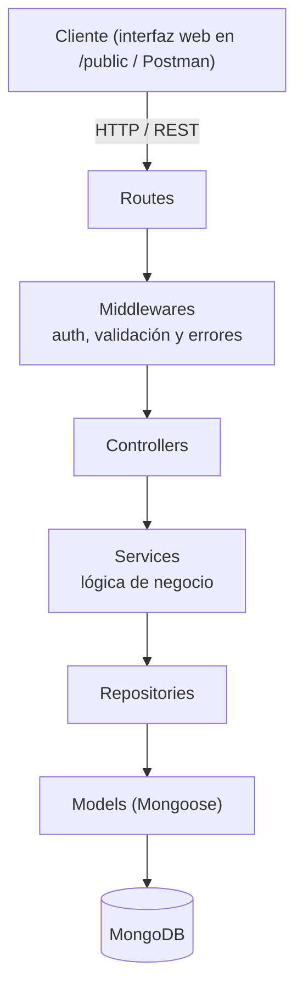

# TurnHub

API backend para que negocios pequeños gestionen su fila de espera con turnos digitales. Los clientes consultan sucursales, toman turno y ven su posición desde el celular. El personal del negocio llama al siguiente turno y marca los turnos atendidos, cancelados o no presentados.

Proyecto integrador del curso **Tecnologías de desarrollo en el servidor** (ITESO).

**Equipo:** Emilio Segura, Yeshua Miranda, Fabricio Rodríguez

## Estado del proyecto (entrega 2 de 4)

| Feature | Descripción | Responsable | Estado |
| --- | --- | --- | --- |
| 1 | Ver tiendas registradas (`GET /api/stores`) | Equipo | Listo |
| 2 | Registrar una empresa (`POST /api/stores`, requiere admin) | Equipo | Listo |
| 3 | Entrar a la cola y consultar su estado | Equipo | Listo |
| 4 | Avanzar la fila y cambiar el estado de un turno (requiere personal de la tienda) | Emilio Segura | Listo |
| 5 | Consultar mi turno y mi posición en la fila | Fabricio Rodríguez | Listo |
| 6 | Estadísticas de la fila y tiempo estimado de espera | Yeshua Miranda | Listo |
| — | Autenticación JWT, roles y propiedad de tienda | Equipo | Listo |

**Pendiente para las siguientes entregas:** actualizaciones en tiempo real con WebSockets, códigos QR por sucursal, subida de logotipos, pruebas de integración con una base de datos temporal y despliegue.

## Stack

- Node.js + Express 5 + TypeScript
- MongoDB + Mongoose (replica set para transacciones)
- Zod (validación de datos)
- JWT (`jsonwebtoken`) + `bcryptjs` (autenticación)
- Jest + Supertest (pruebas)

## Arquitectura



Las rutas definen los endpoints y qué middlewares aplican, los controladores manejan la petición y respuesta HTTP, los servicios contienen la lógica de negocio y solo los repositorios acceden a MongoDB.

## Estructura del proyecto

```
TurnHub/
├── src/
│   ├── config/          # env.ts, database.ts
│   ├── controllers/     # auth, store, queue
│   ├── middlewares/     # auth.ts, validate.ts, errorHandler.ts
│   ├── models/          # user, store, ticket
│   ├── repositories/    # user, store, queue
│   ├── routes/          # index, auth, store, queue
│   ├── services/        # auth, store, queue
│   ├── types/           # type.ts
│   ├── app.ts           # configuración de Express
│   └── server.ts        # punto de entrada
├── tests/               # Jest + Supertest
├── public/              # interfaz web (SPA sin build) servida en "/"
│   ├── css/styles.css
│   └── js/              # app.js (rutas), api.js, state.js, ui.js, views/
├── postman/             # colección con todas las features
├── docker-compose.yml   # MongoDB 7 como replica set
└── .env.example
```

## Roles y permisos

| Rol | Cómo se obtiene | Qué puede hacer |
| --- | --- | --- |
| Cliente | No necesita cuenta | Ver tiendas, tomar turno, consultar la fila, su turno y las estadísticas |
| `admin` (dueño del negocio) | `POST /api/auth/register` | Registrar tiendas (queda como dueño), crear operadores y gestionar la fila **solo de sus tiendas** |
| `operator` (recepcionista) | Lo crea el admin con `POST /api/stores/:storeId/operators` | Gestionar la fila **solo de la tienda asignada** |

Los endpoints protegidos esperan el header `Authorization: Bearer <token>`. Sin token o con un token inválido o expirado se responde `401`. Con un rol sin permiso, o si la tienda no pertenece al usuario, se responde `403`.

## Estados de un turno

La API y la base de datos usan valores de máquina estables. La interfaz muestra las etiquetas en español (también vienen en `statusLabel` al consultar un turno).

| Valor (API) | Etiqueta | Puede pasar a |
| --- | --- | --- |
| `waiting` | En espera | `serving` (al llamar al siguiente), `cancelled` |
| `serving` | En atención | `completed`, `no_show` |
| `completed` | Completado | — (final) |
| `cancelled` | Cancelado | — (final) |
| `no_show` | No se presentó | — (final) |

## Consistencia de la fila

- **Número de turno:** sale de un contador atómico (`$inc`) en la tienda, así que dos clientes que toman turno al mismo tiempo nunca reciben el mismo número. El índice único `(storeId, ticketNumber)` queda como red de seguridad.
- **Llamar al siguiente turno:** se ejecuta en una **transacción de MongoDB**. Completa el turno en atención y promueve el siguiente en espera como una sola unidad; si algo falla, se revierte todo. Si dos personas presionan "siguiente" al mismo tiempo, la transacción detecta el conflicto y reintenta con los datos actualizados.
- **Un solo turno en atención (RN-19):** además, un índice parcial único `{ storeId }` con filtro `status: "serving"` impide a nivel base de datos que una tienda tenga dos turnos en atención.

Las transacciones requieren que MongoDB corra como **replica set**. El `docker-compose.yml` del repo ya lo levanta así, y MongoDB Atlas también lo soporta.

## Instalación y ejecución

### Requisitos previos

- Node.js 20 o superior
- Docker Desktop (o una cuenta de MongoDB Atlas)

### Pasos

```bash
git clone https://github.com/FabXix/TurnHub.git
cd TurnHub
npm install
copy .env.example .env      # Windows   (macOS/Linux: cp .env.example .env)
docker compose up -d        # MongoDB como replica set
npm run dev
```

Contenido de `.env`:

```
PORT=3000
MONGODB_URI=mongodb://localhost:27017/turnhub?replicaSet=rs0&directConnection=true
NODE_ENV=development
JWT_SECRET=cambia-este-secreto-por-uno-largo-y-aleatorio
JWT_EXPIRES_IN=8h
```

Con Atlas, reemplaza `MONGODB_URI` por la cadena `mongodb+srv://...` que te da Atlas. `JWT_SECRET` es obligatorio cuando `NODE_ENV=production`.

Si todo salió bien verás `MongoDB conectado` y `TurnHub escuchando en http://localhost:3000`. La interfaz web está en `http://localhost:3000/` y el health check en `/health`.

### Si ya tenías el contenedor de Mongo de la entrega anterior

El contenedor viejo no corría como replica set. Recréalo (esto borra los datos de prueba, que además usaban los estados viejos en español):

```bash
docker compose down -v
docker compose up -d
```

### Problemas comunes en Windows (PowerShell)

- Si `npm` dice que la ejecución de scripts está deshabilitada: usa `npm.cmd`, o ejecuta `Set-ExecutionPolicy -Scope CurrentUser -ExecutionPolicy RemoteSigned`, o usa una terminal **cmd**.
- Si la API responde *"MongoDB debe ejecutarse como replica set"*, revisa que `MONGODB_URI` incluya `replicaSet=rs0` y que el contenedor se haya creado con el `docker-compose.yml` actual.
- Postman web no llega a `localhost`: usa la app de escritorio de Postman o el *Desktop Agent*.

## Pruebas

```bash
npm test
```

48 casos con Jest + Supertest: validaciones, reglas de negocio, autenticación (`401`/`403`), permisos por tienda, reintentos del número de turno y manejo de la transacción de "siguiente turno". Estas pruebas mockean la capa de repositorio, así que no necesitan MongoDB. Para la entrega 3 se agregarán pruebas de integración contra una base de datos temporal.

## API

Base: `http://localhost:3000/api`. 🔒 = requiere token.

| Método | Endpoint | Acceso | Feature |
| --- | --- | --- | --- |
| POST | `/auth/register` | Público | Auth |
| POST | `/auth/login` | Público | Auth |
| GET | `/auth/me` | 🔒 cualquier usuario | Auth |
| GET | `/stores` | Público | 1 |
| GET | `/stores/:id` | Público | 1 |
| POST | `/stores` | 🔒 admin | 2 |
| POST | `/stores/:storeId/operators` | 🔒 admin dueño | Auth |
| POST | `/stores/:storeId/queue` | Público | 3 |
| GET | `/stores/:storeId/queue` | Público | 3 |
| PATCH | `/stores/:storeId/queue/next` | 🔒 admin dueño u operador de la tienda | 4 |
| GET | `/stores/:storeId/tickets` | 🔒 admin dueño u operador de la tienda | 4 |
| PATCH | `/stores/:storeId/tickets/:ticketId` | 🔒 admin dueño u operador de la tienda | 4 |
| GET | `/stores/:storeId/tickets/:ticketId` | Público | 5 |
| GET | `/stores/:storeId/queue/stats` | Público | 6 |

Todos los errores responden `{ "error": "mensaje", "details"?: [...] }`.

### Autenticación

**`POST /api/auth/register`**: crea una cuenta de administrador.

```json
{ "name": "Ana López", "email": "ana@barberia.com", "password": "secreta123" }
```

`201` → `{ "user": { "id", "name", "email", "role": "admin", "storeId": null }, "token": "eyJ..." }`
`400` datos inválidos (contraseña de 8 a 72 caracteres) · `409` el correo ya existe

**`POST /api/auth/login`**: `{ "email", "password" }` → `200` con `user` y `token` · `401` credenciales incorrectas

**`POST /api/stores/:storeId/operators`** 🔒 admin dueño: mismo body que register → `201` con el operador (`role: "operator"`, `storeId` de la tienda) · `403` si la tienda no es suya

### Feature 1: ver tiendas

**`GET /api/stores`** → `200` con la lista (o `[]`). **`GET /api/stores/:id`** → `200`, `400` id inválido, `404` no existe.

### Feature 2: registrar una empresa 🔒 admin

**`POST /api/stores`**. Todos los campos son obligatorios (RN-01):

| Campo | Reglas |
| --- | --- |
| `name` | 2 a 100 caracteres, único |
| `description` | 1 a 500 caracteres |
| `address` | 1 a 200 caracteres |
| `phone` | Exactamente 10 dígitos |
| `email` | Correo válido |

```json
{
  "name": "Barbería El Corte",
  "description": "Cortes y barba",
  "address": "Av. Vallarta 123, Guadalajara",
  "phone": "3312345678",
  "email": "contacto@elcorte.com"
}
```

`201` empresa creada con `_id` y `ownerId` · `400` datos inválidos (detalle por campo) · `401` sin token · `403` no es admin · `409` nombre repetido

### Feature 3: entrar a la cola

**`POST /api/stores/:storeId/queue`** (sin body) → `201` con el turno (`ticketNumber`, `status: "waiting"`, `createdAt`) · `400` id inválido · `404` tienda inexistente · `503` demasiadas colisiones simultáneas (raro; se puede reintentar)

**`GET /api/stores/:storeId/queue`** → `200`:

```json
{ "storeId": "665f...", "lastTicketNumber": 8, "waitingCount": 3, "currentTicketNumber": 5 }
```

### Feature 4: avanzar la fila 🔒 personal de la tienda

**`PATCH /api/stores/:storeId/queue/next`** (sin body) → `200`:

```json
{
  "previousTicket": { "ticketNumber": 4, "status": "completed", "finishedAt": "..." },
  "currentTicket":  { "ticketNumber": 5, "status": "serving", "calledAt": "..." }
}
```

`previousTicket` es `null` si nadie estaba en atención. `404` si no hay turnos en espera (no se modifica nada) · `409` si la fila cambió durante la operación · `401`/`403` sin permiso.

**`GET /api/stores/:storeId/tickets?status=waiting,serving`**: lista los turnos de la tienda en orden de llegada (máximo 200), cada uno con su `statusLabel`. `status` es opcional y acepta varios estados separados por comas. Es lo que usa el panel de atención para cancelar o cerrar turnos. `200` · `400` estado inválido · `401`/`403` sin permiso.

**`PATCH /api/stores/:storeId/tickets/:ticketId`**: `{ "status": "completed" | "cancelled" | "no_show" }` → `200` con el turno actualizado · `400` estado o id inválido · `404` turno inexistente en esa tienda · `409` transición no permitida · `401`/`403` sin permiso.

### Feature 5: consultar mi turno

**`GET /api/stores/:storeId/tickets/:ticketId`** → `200`:

```json
{
  "id": "...", "storeId": "...", "ticketNumber": 7,
  "status": "waiting", "statusLabel": "En espera",
  "position": 3, "aheadOfYou": 2,
  "createdAt": "...", "calledAt": null, "finishedAt": null
}
```

`position` y `aheadOfYou` son `null` si el turno ya no está en espera. `400` id inválido · `404` tienda o turno inexistente.

### Feature 6: estadísticas de la fila

**`GET /api/stores/:storeId/queue/stats`** → `200`:

```json
{
  "storeId": "665f...",
  "waitingCount": 3, "currentlyServing": 7,
  "completedCount": 25, "cancelledCount": 2, "noShowCount": 1,
  "averageServiceMinutes": 4.13, "estimatedWaitMinutes": 13
}
```

El promedio usa los últimos 20 turnos completados. Si no hay datos, los tiempos son `null`. `400` id inválido · `404` tienda inexistente.

## Interfaz web

Con el servidor corriendo, abre `http://localhost:3000/`. Es una SPA en JavaScript puro (sin paso de build) dentro de `public/`, servida por `express.static`. Navega con rutas hash, así que cada pantalla tiene su propio enlace.

### Flujo del cliente (sin cuenta)

| Pantalla | Ruta | Features |
| --- | --- | --- |
| Negocios: lista con buscador y personas en espera de cada uno | `#/` | 1, 3 |
| Negocio: datos, fila en vivo, estadísticas y botón **Tomar turno** | `#/tienda/:id` | 1, 3, 6 |
| Mi turno: número, posición, personas delante y espera aproximada. Avisa con sonido y vibración cuando lo llaman | `#/turno/:storeId/:ticketId` | 5, 6 |
| Mis turnos: los turnos tomados en este dispositivo (se guardan en `localStorage`) | `#/mis-turnos` | 5 |
| Pantalla de turnos para una TV del negocio | `#/pantalla/:id` | 3, 6 |

### Flujo del negocio

1. **Acceso negocios** (`#/acceso`): el dueño crea su cuenta (admin) o inicia sesión. El recepcionista solo inicia sesión.
2. **Mi panel** (`#/panel`, solo admin): sus negocios con la fila en vivo y el formulario para registrar uno nuevo (Feature 2).
3. **Panel de atención** (`#/gestionar/:id`, admin dueño u operador de esa tienda):
   - **Llamar siguiente turno**: completa el que estaba en atención y llama al siguiente (Feature 4).
   - Sobre el turno en atención: **Atendido** o **No se presentó**.
   - En la lista de espera: **Cancelar** (pide confirmar con un segundo clic).
   - Estadísticas de la fila (Feature 6).
   - Solo el admin: **crear recepcionistas** para esa tienda.

El operador entra directo al panel de su tienda. Si intenta abrir otra tienda, la interfaz muestra el mensaje de falta de permiso (la API responde `403`). Si el token expira, se cierra la sesión y se vuelve a pedir el login.

**Para probarlo de punta a punta:** abre el panel de atención en una ventana, la vista del cliente o "Mi turno" en otra (o en el celular, en la misma red) y la pantalla de turnos en una tercera. Todas se actualizan solas cada pocos segundos.

## Postman

Importa `postman/TurnHub.postman_collection.json` y córrela en orden. El primer request crea un admin con correo único y guarda el token y los ids en variables de la colección, así que no hay que copiar nada a mano.

## Flujo de trabajo en equipo

1. Antes de empezar: `git pull origin main`
2. Crea una rama: `git checkout -b feature/nombre`
3. Haz tus cambios y corre `npm test`
4. `git add .`, `git commit -m "descripción"`, `git push -u origin feature/nombre`
5. Abre un Pull Request hacia `main`

## Licencia

Trabajo académico.
