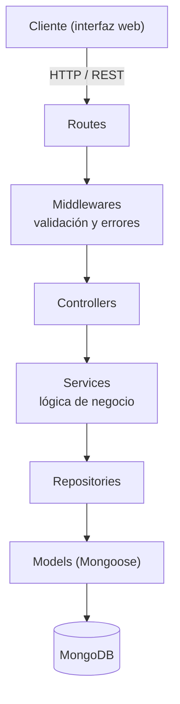

# TurnHub

API backend para gestionar tiendas, filas de espera y turnos de atención. Pensada para que los clientes consulten sucursales y soliciten turnos, y para que los administradores gestionen la fila.

Proyecto integrador del curso **Tecnologías de desarrollo en el servidor**.

**Equipo:** Emilio Segura, Yeshua Miranda, Fabricio Rodríguez

## Estado del proyecto (primera entrega)

| Feature | Descripción | Estado |
| --- | --- | --- |
| 1 | Ver tiendas registradas (`GET /api/stores`) | Pendiente |
| 2 | Registrar una empresa (`POST /api/stores`) | Listo |
| 3 | Entrar a la cola de una tienda | Pendiente |

## Stack

- Node.js + Express + TypeScript
- MongoDB + Mongoose
- Zod (validación de datos)
- Jest + Supertest (pruebas)

## Arquitectura



Cada capa tiene una sola responsabilidad: las rutas definen los endpoints, los controladores manejan la petición y respuesta HTTP, los servicios contienen la lógica de negocio, y solo los repositorios acceden a MongoDB mediante los modelos.

## Estructura del proyecto

```
TurnHub/
├── src/
│   ├── config/          # env.ts, database.ts
│   ├── controllers/     # store.controller.ts, queue.controller.ts
│   ├── middlewares/     # validate.ts, errorHandler.ts
│   ├── models/          # store.model.ts, ticket.model.ts
│   ├── repositories/    # store.repository.ts, queue.repository.ts
│   ├── routes/          # index.ts, store.routes.ts, queue.routes.ts
│   ├── services/        # store.service.ts, queue.service.ts
│   ├── types/           # type.ts
│   ├── app.ts           # configuración de Express
│   └── server.ts        # punto de entrada
├── tests/
├── .env.example
├── jest.config.js
├── package.json
├── tsconfig.json
└── README.md
```

## Requisitos previos

- [Node.js](https://nodejs.org) 18 o superior (incluye npm)
- [Git](https://git-scm.com)
- MongoDB, de una de estas dos formas:
  - **Local:** [MongoDB Community Server](https://www.mongodb.com/try/download/community) corriendo en el puerto 27017
  - **Remota:** una base gratuita en [MongoDB Atlas](https://www.mongodb.com/atlas) (necesitas su cadena de conexión)
- **Con Docker:** `docker compose up -d` levanta MongoDB sin instalar nada
## Instalación y ejecución

### 1. Clonar el repositorio

```bash
git clone https://github.com/FabXix/TurnHub.git
cd TurnHub
```

### 2. Instalar dependencias

```bash
npm install
```

### 3. Configurar variables de entorno

Copia el archivo de ejemplo y créalo como `.env`:
`docker compose up -d` levanta MongoDB sin instalar nada
```bash
# Windows (cmd o PowerShell)
copy .env.example .env

# macOS / Linux
cp .env.example .env
```

Contenido por defecto:

```
PORT=3000
MONGODB_URI=mongodb://localhost:27017/turnhub
NODE_ENV=development
```

Si usas MongoDB Atlas, reemplaza `MONGODB_URI` por tu cadena de conexión. El archivo `.env` **no se sube a GitHub**, cada persona crea el suyo.

### 4. Levantar el servidor

Modo desarrollo (se reinicia al guardar cambios):

```bash
npm run dev
```

Modo producción:

```bash
npm run build
npm start
```

Si todo salió bien verás:

```
MongoDB conectado
TurnHub escuchando en http://localhost:3000
```

Puedes comprobarlo abriendo `http://localhost:3000/health`, que responde `{"status":"ok"}`.

### Problemas comunes en Windows (PowerShell)

Si `npm` marca que la ejecución de scripts está deshabilitada, tienes tres opciones:

- Usar `npm.cmd` en lugar de `npm` (por ejemplo `npm.cmd install`).
- Habilitar scripts solo para tu usuario: `Set-ExecutionPolicy -Scope CurrentUser -ExecutionPolicy RemoteSigned`
- Usar una terminal **cmd** en lugar de PowerShell.

Si `npm run dev` falla con un error de conexión a Mongo, revisa que MongoDB esté corriendo y que `MONGODB_URI` sea correcta.

## Pruebas

```bash
npm test
```

Las pruebas no necesitan MongoDB: mockean la capa de repositorio.

## API

URL base: `http://localhost:3000/api`

### `POST /api/stores` — Registrar una empresa

**Body (JSON):**

| Campo | Tipo | Obligatorio | Reglas |
| --- | --- | --- | --- |
| `name` | string | Sí | 2 a 100 caracteres, único |
| `description` | string | No | Máx. 500 caracteres |
| `address` | string | No | Máx. 200 caracteres |
| `phone` | string | No | 7 a 20 caracteres (dígitos, `+`, `-`, espacios, paréntesis) |
| `email` | string | No | Correo válido |

**Ejemplo:**

```bash
curl -X POST http://localhost:3000/api/stores \
  -H "Content-Type: application/json" \
  -d '{"name":"Barbería El Corte","description":"Cortes y barba","phone":"33 1234 5678"}'
```

En PowerShell conviene usar `curl.exe` o una herramienta como Postman / Thunder Client.

**Respuestas:**

| Código | Cuándo |
| --- | --- |
| `201` | Empresa creada. Devuelve el documento con su `_id` |
| `400` | Datos inválidos o JSON mal formado. Devuelve el detalle por campo |
| `409` | Ya existe una empresa con ese nombre |
| `500` | Error interno del servidor |

**Ejemplo de `201`:**

```json
{
  "_id": "665f1c2e8b3a4d0012345678",
  "name": "Barbería El Corte",
  "description": "Cortes y barba",
  "address": "",
  "phone": "33 1234 5678",
  "email": "",
  "createdAt": "2026-10-14T20:00:00.000Z",
  "updatedAt": "2026-10-14T20:00:00.000Z"
}
```

**Ejemplo de `400`:**

```json
{
  "error": "Datos inválidos",
  "details": [{ "field": "name", "message": "El nombre es obligatorio" }]
}
```

## Flujo de trabajo en equipo

1. Antes de empezar a trabajar: `git pull origin main`
2. Crea una rama para tu feature: `git checkout -b feature/nombre-de-la-feature`
3. Haz tus cambios y corre `npm test`
4. Sube tu rama: `git add .`, `git commit -m "descripción"`, `git push -u origin feature/nombre-de-la-feature`
5. Abre un Pull Request en GitHub hacia `main`

## Licencia

Trabajo académico.