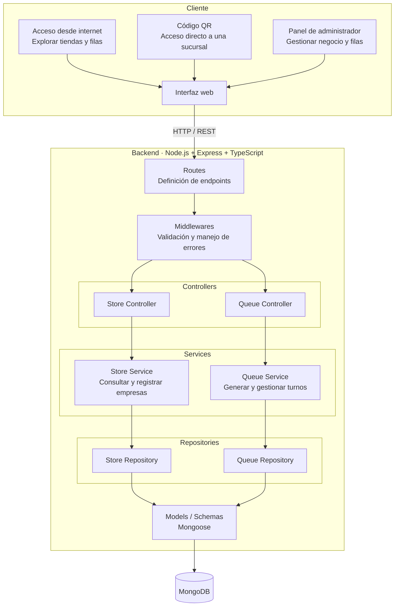

# TurnHub

TurnHub es una API backend para gestionar tiendas, filas de espera y turnos de atención. La aplicación está pensada para permitir a los clientes consultar sucursales y a los administradores administrar la cola de atención en tiempo real.

## Diagrama general



## Stack tecnológico

- Node.js
- Express
- TypeScript
- MongoDB + Mongoose
- Jest / Supertest para pruebas

## Requisitos previos

Antes de ejecutar el proyecto, asegúrate de tener instalado:

- Node.js 18 o superior
- npm
- MongoDB local o una base remota (MongoDB Atlas)
- Git

## Clonar el repositorio

```bash
git clone https://github.com/FabXix/TurnHub.git
cd TurnHub
```

## Instalación de dependencias

```bash
npm install
```

## Configuración de variables de entorno

Crea un archivo `.env` en la raíz del proyecto basado en `.env.example`:

```bash
cp .env.example .env
```

Ejemplo de contenido:

```env
PORT=3000
MONGODB_URI=mongodb://localhost:27017/turnhub
NODE_ENV=development
```

> Ajusta la URL de MongoDB según tu entorno local o remoto.

## Cómo ejecutar la aplicación

### Modo desarrollo

```bash
npm run dev
```

### Modo producción

```bash
npm run build
npm run start
```

## Ejecutar pruebas

```bash
npm test
```

## Estructura del proyecto

```text
src/
  app.ts
  server.ts
  config/
  controllers/
  middlewares/
  models/
  repositories/
  routes/
  services/
  types/

tests/
```

## Endpoints principales

El backend está organizado por módulos para:

- gestionar tiendas
- gestionar filas y tickets
- validar entradas
- manejar errores de forma centralizada

## Notas importantes

- Si el proyecto aún no tiene scripts definidos en `package.json`, debes agregarlos antes de ejecutar `npm run dev` o `npm run start`.
- En ese caso, la opción más directa es iniciar la app con TypeScript directamente:

```bash
npx tsx watch src/server.ts
```

o, si prefieres `ts-node-dev`:

```bash
npx ts-node-dev --respawn src/server.ts
```

## Contribución

1. Crear una rama nueva
2. Hacer los cambios
3. Ejecutar pruebas
4. Hacer commit y abrir un pull request

## Licencia

Este proyecto se entrega como trabajo académico / de desarrollo interno. Revisa la licencia del repositorio antes de usarlo en producción.
